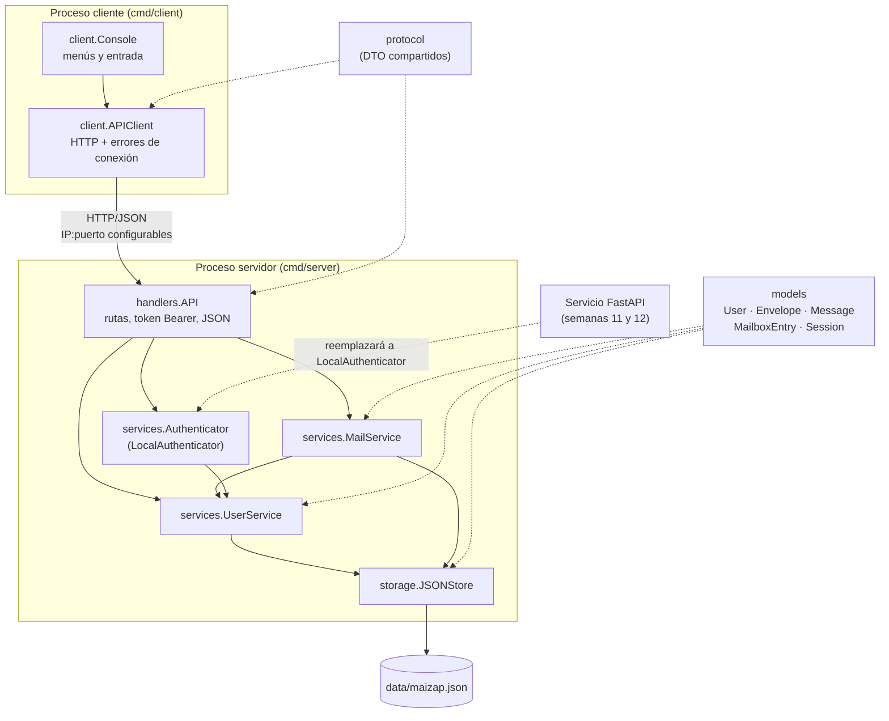
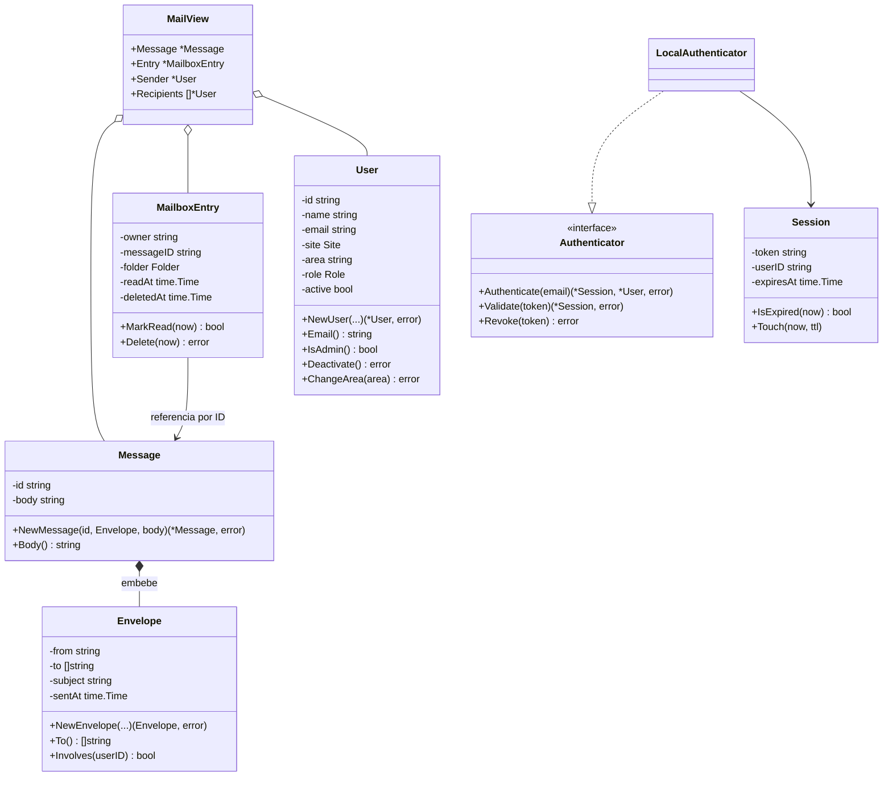
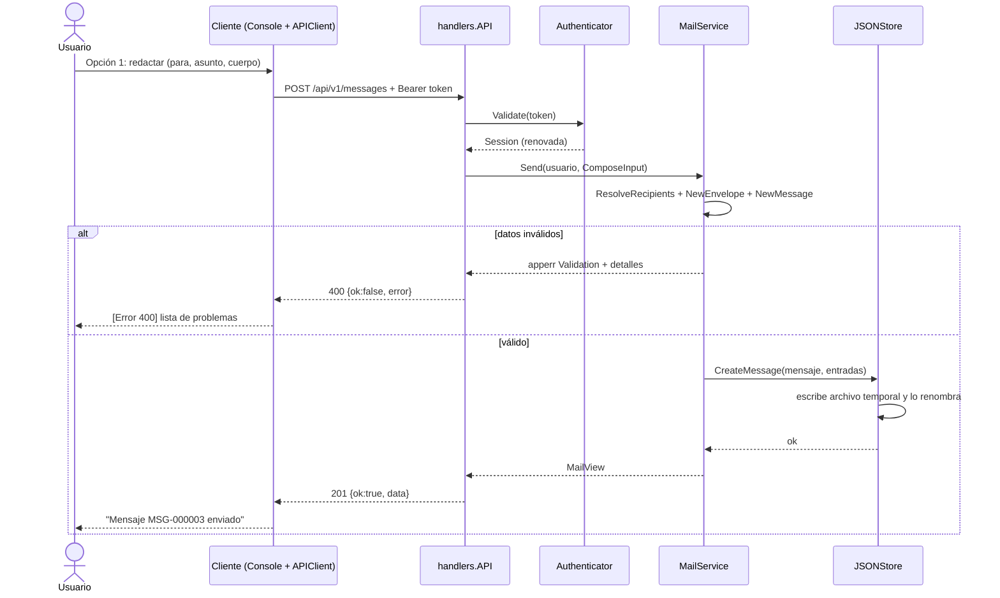

# Documentación técnica · Segundo entregable

## Portada

| | |
|---|---|
| **Proyecto** | Proyecto Integrador · Tercer semestre |
| **Asignatura** | Programación Orientada a Objetos |
| **Entregable** | Segundo entregable (semana 10): prototipo funcional cliente-servidor en Go |
| **Sistema seleccionado** | **Opción A · Sistema de correos internos («MaiZap»)** |
| **Integrantes** | Emilio Cuenca · Danna Simaluisa · Camila Villagran |
| **Fecha** | Noviembre de 2026 |

---

## 1. Objetivo del prototipo

Construir una primera versión ejecutable y modular del sistema de correos internos, con un servidor y un cliente en Go que se ejecuten como procesos independientes y se comuniquen por red. El prototipo debe permitir registrar e identificar usuarios, enviar mensajes internos, consultar la bandeja de entrada y los enviados, leer y eliminar mensajes, y validar destinatarios y datos obligatorios. El código debe aplicar structs, constructores, métodos, encapsulamiento, composición, manejo explícito de errores y separación por paquetes.

## 2. Funcionalidades implementadas

| Funcionalidad exigida (Opción A) | Implementación | Estado |
|---|---|---|
| Registrar o identificar usuarios | `POST /api/v1/users`, `POST /api/v1/sessions` (token de sesión) | Completa |
| Crear y enviar un mensaje interno | `POST /api/v1/messages`, con uno o varios destinatarios | Completa |
| Consultar la bandeja de entrada | `GET /api/v1/mailbox/inbox`, con indicador de no leídos | Completa |
| Consultar los mensajes enviados | `GET /api/v1/mailbox/sent` | Completa |
| Leer el contenido de un mensaje | `GET /api/v1/messages/{id}`, que lo marca como leído | Completa |
| Eliminar un mensaje | `DELETE /api/v1/messages/{id}`, con eliminación lógica por buzón | Completa |
| Validar destinatarios y datos obligatorios | Validación en los constructores del modelo y en los servicios; se devuelven todos los problemas a la vez | Completa |
| Funciones adicionales | Directorio de usuarios, desactivación de usuarios por un administrador, cierre de sesión, expiración por inactividad | Completas |

## 3. Requisitos atendidos y requisitos pendientes

Los códigos corresponden a los requisitos mínimos oficiales del documento del Proyecto Integrador (sección 4). Para cada requisito se indica su estado en este entregable. Los requisitos de red, seguridad, estadística y Tecnología y Sociedad se desarrollan en otras asignaturas y en las fases siguientes, por lo que en esta tabla figuran como pendientes o fuera del alcance de la semana 10.

### 3.1 Requisitos funcionales

| Código | Requisito oficial | Estado en la semana 10 | Evidencia o punto de extensión |
|---|---|---|---|
| RF-SW-01 | Aplicación cliente-servidor en Go | **Atendido** en un entorno local o de laboratorio. Falta demostrarlo con el cliente en una sede y el servidor en la otra. | `cmd/server` y `cmd/client` son procesos independientes que se comunican por HTTP/JSON. La IP y el puerto son configurables (`internal/config`). |
| RF-SW-02 | Operaciones principales del sistema seleccionado | **Atendido** (ver el desglose de la tabla 3.2) | `services.UserService`, `services.MailService`, persistencia en `storage.JSONStore` |
| RF-SW-03 | Integración con autenticación | **Parcial**. Los recursos protegidos ya exigen una sesión válida (401 sin token), pero hoy la sesión la emite `LocalAuthenticator` y no el servicio FastAPI. | Interfaz `services.Authenticator` y middleware `requireSession`. La integración con FastAPI está prevista para las semanas 11 y 12. |
| RF-SEC-01 | Registro, inicio de sesión y autorización | **Parcial**. La autorización funciona: mensajes ajenos y desactivación de usuarios sin ser administrador devuelven 403. El registro existe. Las credenciales quedan a cargo de FastAPI. | `MailService.ownedEntry`, `UserService.Deactivate`, `UserService.Register` |
| RF-SEC-02 | Protección de credenciales (hash seguro) | **No aplica a Go**. El servidor Go no almacena contraseñas, por decisión de diseño. | Lo implementa el servicio FastAPI (Fundamentos de Seguridad). |
| RF-SEC-03 | Firewall y segmentación segura | Pendiente (componente de red) | El puerto configurable permite definir reglas de firewall específicas. |
| RF-NET-01 a RF-NET-04 | Sedes interconectadas, VLAN, OSPF, EtherChannel y RSTP | Fuera del alcance de este entregable (componente de red) | Se integran en las semanas 11 y 12. |
| RF-EST-01 | Recolección de datos | **Parcial**. El servidor registra cada solicitud con ruta, código de estado y duración. | `handlers.logRequests`. Falta definir el instrumento de medición. |
| RF-EST-02 | Análisis estadístico | Pendiente (componente de estadística) | Usará los registros de RF-EST-01. |
| RF-TS-01 | Análisis socio-tecnológico | Pendiente (Tecnología y Sociedad) | — |
| RF-INT-01 | Integración completa | Pendiente (semanas 11 y 12) | — |

### 3.2 Desglose de RF-SW-02 según la Opción A de la guía

| Operación exigida | Estado | Evidencia en el código |
|---|---|---|
| Registrar o identificar usuarios | Atendido | `UserService.Register`, `LocalAuthenticator.Authenticate` |
| Crear y enviar un mensaje interno | Atendido | `MailService.Send` |
| Consultar la bandeja de entrada | Atendido | `MailService.Inbox` |
| Consultar los mensajes enviados | Atendido | `MailService.Sent` |
| Leer el contenido de un mensaje | Atendido | `MailService.Read`, `MailboxEntry.MarkRead` |
| Eliminar un mensaje | Atendido | `MailService.Delete`, `MailboxEntry.Delete` |
| Validar destinatarios y datos obligatorios | Atendido | `UserService.ResolveRecipients`, `models.NewEnvelope`, `models.NewMessage` |

### 3.3 Requisitos no funcionales

| Código | Requisito oficial | Estado en la semana 10 | Evidencia |
|---|---|---|---|
| RNF-01 | Rendimiento | **Parcial**. Ya se mide la duración de cada solicitud. Falta definir un umbral y compararlo. | Registro por solicitud en el log del servidor |
| RNF-02 | Disponibilidad | **Parcial**. El servidor no se detiene ante errores de solicitud y se apaga de forma ordenada. | Middleware `recoverer`, `server.Shutdown` |
| RNF-03 | Seguridad | **Parcial**. Hay validación de entradas, mínimo privilegio (cada usuario accede solo a su buzón; desactivar usuarios es exclusivo del administrador) y no se guardan credenciales en Go. Faltan el firewall y TLS. | `decodeJSON`, constructores del modelo, `requireSession` |
| RNF-04 | Mantenibilidad | **Atendido**: código modular por capas, configuración documentada y README actualizado. | Estructura `cmd/` + `internal/`, `go test ./...` |
| RNF-05 | Usabilidad y accesibilidad | **Parcial**. El cliente de consola tiene menús numerados consistentes, mensajes de error claros y confirmación antes de eliminar. Falta la evaluación con usuarios o con criterios definidos. | `client.Console` |
| RNF-06 | Escalabilidad | **Parcial**. Las capas y la interfaz `Authenticator` permiten agregar servicios sin rediseñar. El almacenamiento JSON limita la cantidad de usuarios. | `internal/storage` aislado |
| RNF-07 | Validación científica | **Parcial**. Las pruebas automatizadas son repetibles. Falta reunir evidencia cuantitativa. | `models_test.go`, `services_test.go`, `api_test.go` |

### 3.4 Cambios respecto al diseño previo

| Cambio | Justificación |
|---|---|
| La identificación usa solo el correo, sin contraseña | La guía de la semana 10 pide no duplicar en Go el servicio de autenticación de Fundamentos de Seguridad. La interfaz `Authenticator` permite reemplazar la implementación sin tocar los handlers. |
| Se usa un archivo JSON en lugar de una base de datos | La guía permite archivos o JSON justificados. Reduce dependencias y hace reproducible la demostración. `JSONStore` queda aislado en `internal/storage`, por lo que se puede cambiar sin afectar a los servicios. |
| Se agregó la desactivación de usuarios por un administrador | Permite demostrar el manejo de «operaciones no autorizadas» y la validación de destinatarios desactivados. |

## 4. Diagrama de componentes y módulos



### Diagrama de estructuras



## 5. Comunicación cliente-servidor

- **Transporte**: HTTP/1.1 sobre TCP. El servidor escucha en `host:port`, configurables con `-host` y `-port` o con `MAIZAP_HOST` y `MAIZAP_PORT`. El cliente se conecta con `-host` y `-port` o con `MAIZAP_SERVER_HOST` y `MAIZAP_SERVER_PORT`.
- **Formato**: JSON. Toda respuesta usa el sobre `{"ok": bool, "data": ..., "error": {"code","message","details"}}`, definido en `internal/protocol`, que comparten ambos programas.
- **Sesión**: `POST /api/v1/sessions` devuelve un token aleatorio de 192 bits. El cliente lo envía en `Authorization: Bearer <token>`. Cada uso renueva la expiración (30 minutos por defecto).
- **Errores**: cada categoría de `apperr` se traduce en un código HTTP (400, 401, 403, 404, 409 o 500). El cliente distingue entre un **error de conexión** (servidor apagado, IP o puerto incorrectos, tiempo agotado) y un **error de la aplicación** (respuesta del servidor con mensaje y detalles).



## 6. Principales estructuras, constructores y métodos

| Concepto de POO | Dónde se aplica |
|---|---|
| **Structs para las entidades** | `models.User`, `models.Envelope`, `models.Message`, `models.MailboxEntry`, `models.Session` |
| **Campos no exportados** | Todos los campos de las entidades son privados. Se leen con métodos (`Email()`, `Subject()`, `IsRead()`...), así que ningún paquete externo puede dejar una entidad en un estado inválido. |
| **Campos exportados** | Los DTO de `protocol`, los registros de `storage` (`UserRecord`...) y `services.MailView`, porque su responsabilidad es transportar datos y serializarlos a JSON. |
| **Constructores con estado válido** | `NewUser`, `NewEnvelope`, `NewMessage`, `NewMailboxEntry`, `NewSession`, `NewUserService`, `NewMailService`, `NewLocalAuthenticator`, `NewAPI`, `NewAPIClient`, `NewConsole`, `OpenJSONStore`. Los constructores del modelo devuelven `(*T, error)` y acumulan todos los problemas encontrados. |
| **Receptores por puntero** | `(*User).Deactivate`, `(*User).ChangeArea`, `(*MailboxEntry).MarkRead`, `(*MailboxEntry).Delete` y `(*Session).Touch` modifican el estado. Los servicios y el almacén usan punteros para compartir su `sync.Mutex`. |
| **Receptores por valor** | `Envelope` es inmutable y sus métodos (`To()`, `Involves()`) usan receptor por valor. `To()` devuelve una copia del slice para proteger el estado interno. |
| **Encapsulamiento** | La entidad solo cambia mediante sus métodos: por ejemplo, `Delete` impide eliminar dos veces y `MarkRead` es idempotente. El almacén devuelve copias, nunca referencias a su estado interno. |
| **Composición** | `Message` **embebe** `Envelope`, por lo que sus métodos (`From()`, `Subject()`, `SentAt()`) se promueven. `MailView` compone mensaje, entrada de buzón, remitente y destinatarios. `MailService` contiene un `UserService`, y `handlers.API` agrupa los servicios. |
| **Interfaz con propósito** | `services.Authenticator` separa la identificación del resto del servidor. Su única implementación actual, `LocalAuthenticator`, se reemplazará por un adaptador del servicio FastAPI. No se crearon interfaces que no tengan ese propósito. |
| **Reutilización** | `writeData`, `writeError`, `decodeJSON` y el middleware `requireSession` en `handlers`; `APIClient.do` en el cliente; `combineValidation` en `services`. |
| **Manejo explícito de errores** | El tipo `apperr.Error` tiene categoría, mensaje, detalles y causa (`Unwrap`), y se consulta con `errors.As`. El cliente define `ConnectionError` y `APIError`. No se usa `panic`. Un middleware `recoverer` evita que un fallo inesperado detenga el servidor. |
| **Validación de datos del cliente** | `decodeJSON` (tipo de contenido, tamaño máximo, campos desconocidos, objeto único), los constructores del modelo y `ResolveRecipients`. |

## 7. Gestión de los datos

- `storage.JSONStore` guarda usuarios, mensajes y entradas de buzón en `data/maizap.json`.
- Un mensaje se guarda **una sola vez**, y cada participante tiene una `MailboxEntry` (carpeta `inbox` o `sent`) con su propio estado de lectura y de eliminación. Así, eliminar un mensaje en un buzón no lo borra del buzón de los demás.
- Cada escritura serializa el estado en un archivo temporal y luego lo **renombra**, lo que evita dejar el archivo corrupto si el proceso se interrumpe. Si la escritura falla, se **revierte** el cambio en memoria y se devuelve un error de almacenamiento.
- Al iniciar, el servidor valida cada registro con los constructores del modelo. Un archivo corrupto se informa con un mensaje claro y el servidor no arranca con datos inválidos.
- **Limitación**: las sesiones viven en memoria y se pierden al reiniciar el servidor.

## 8. Evidencias de ejecución

Las salidas siguientes provienen de una ejecución real del prototipo, con el servidor y el cliente como procesos independientes en el mismo equipo (`127.0.0.1:8080`) y los datos de `data/seed.json`. Se omitieron las líneas repetidas del menú.

**Evidencia 1 · Inicio del servidor y registro de solicitudes** (terminal del servidor)

```text
2026/11/09 18:45:41 MaiZap servidor escuchando en http://127.0.0.1:8080
2026/11/09 18:45:41 Datos: data/maizap.json | Sesiones expiran tras 30m0s de inactividad
2026/11/09 18:45:42 127.0.0.1:47652 GET /health -> 200 (120µs)
2026/11/09 18:45:42 127.0.0.1:47652 POST /api/v1/sessions -> 201 (249µs)
2026/11/09 18:45:42 127.0.0.1:47652 GET /api/v1/mailbox/inbox -> 200 (107µs)
2026/11/09 18:45:42 127.0.0.1:47652 GET /api/v1/messages/MSG-000002 -> 200 (180µs)
2026/11/09 18:45:42 127.0.0.1:47652 POST /api/v1/messages -> 400 (44µs)
2026/11/09 18:45:42 127.0.0.1:47652 POST /api/v1/messages -> 201 (270µs)
2026/11/09 18:45:42 127.0.0.1:47652 GET /api/v1/mailbox/sent -> 200 (20µs)
2026/11/09 18:45:42 127.0.0.1:47652 POST /api/v1/users/USR-0003/deactivate -> 403 (21µs)
2026/11/09 18:45:42 127.0.0.1:47652 DELETE /api/v1/messages/MSG-000002 -> 200 (205µs)
2026/11/09 18:45:42 127.0.0.1:47652 DELETE /api/v1/sessions/current -> 200 (16µs)
2026/11/09 18:45:42 127.0.0.1:47652 POST /api/v1/sessions -> 403 (30µs)
2026/11/09 18:45:42 127.0.0.1:47652 POST /api/v1/sessions -> 201 (118µs)
2026/11/09 18:45:42 127.0.0.1:47652 GET /api/v1/mailbox/inbox -> 200 (22µs)
2026/11/09 18:45:42 Apagando servidor...
2026/11/09 18:45:42 Servidor detenido
```

**Evidencia 2 · Conexión del cliente y opción inexistente**

```text
=== MaiZap · Correo interno ===
Conectado a 127.0.0.1:8080 (estado: ok)

--- Menú principal ---
  1) Registrar usuario
  2) Identificarse
  3) Probar conexión con el servidor
  0) Salir
Seleccione una opción: 9
[Error] la opción "9" no existe
```

**Evidencia 3 · Identificación, bandeja de entrada y lectura de un mensaje**

```text
Correo corporativo: ana.torres@maizap.com
Bienvenido/a, Ana Torres. Rol: usuario. La sesión expira tras inactividad (2026-11-09 19:15).

Bandeja de entrada: 1 mensaje(s), 1 sin leer
 * MSG-000002  2026-11-02 10:05  De: luis.paredes@maizap.com       Re: Confirmacion de despacho pedido 1042
  (* = no leído)

ID del mensaje (ej. MSG-000001): MSG-000002
----------------------------------------
ID:      MSG-000002
De:      Luis Paredes <luis.paredes@maizap.com>
Para:    ana.torres@maizap.com, admin@maizap.com
Fecha:   2026-11-02 10:05
Asunto:  Re: Confirmacion de despacho pedido 1042
----------------------------------------
Confirmado, el pedido sale a las 15:00. Copio a TI para registro.
----------------------------------------
```

**Evidencia 4 · Validación de destinatarios y datos obligatorios**

```text
Para (correos separados por coma): luis.paredes@maizap.com, fantasma@maizap.com, x@gmail.com
Asunto:
Cuerpo del mensaje (escriba una línea con solo un punto '.' para terminar):
.
[Error 400] no se pudo enviar el mensaje
   - el destinatario fantasma@maizap.com no existe
   - el correo x@gmail.com no es un correo corporativo válido (@maizap.com)
   - el asunto es obligatorio
   - el cuerpo del mensaje es obligatorio
```

**Evidencia 5 · Envío válido y mensajes enviados**

```text
Para (correos separados por coma): luis.paredes@maizap.com
Asunto: Inventario semanal
Cuerpo del mensaje (escriba una línea con solo un punto '.' para terminar):
Hola Luis,
el inventario de la Sede A esta listo.
.
Mensaje MSG-000003 enviado a luis.paredes@maizap.com.

Mensajes enviados: 2 mensaje(s)
   MSG-000003  2026-11-09 18:45  Para: luis.paredes@maizap.com     Inventario semanal
   MSG-000001  2026-11-02 09:30  Para: luis.paredes@maizap.com     Confirmacion de despacho pedido 1042
```

**Evidencia 6 · Operación no autorizada, eliminación y cuenta desactivada**

```text
ID del usuario a desactivar (ej. USR-0003): USR-0003
[Error 403] solo un administrador puede desactivar usuarios

ID del mensaje a eliminar: MSG-000002
¿Eliminar MSG-000002 de su buzón? (s/n): s
Mensaje MSG-000002 eliminado de su buzón.

Sesión cerrada correctamente.

Correo corporativo: marta.ruiz@maizap.com
[Error 403] la cuenta marta.ruiz@maizap.com está desactivada; contacte al administrador
```

**Evidencia 7 · Recepción del mensaje en la cuenta del destinatario**

```text
Correo corporativo: luis.paredes@maizap.com
Bienvenido/a, Luis Paredes. Rol: usuario. La sesión expira tras inactividad (2026-11-09 19:15).

Bandeja de entrada: 2 mensaje(s), 1 sin leer
 * MSG-000003  2026-11-09 18:45  De: ana.torres@maizap.com         Inventario semanal
   MSG-000001  2026-11-02 09:30  De: ana.torres@maizap.com         Confirmacion de despacho pedido 1042
  (* = no leído)
```

**Evidencia 8 · Error de conexión con el servidor detenido**

```text
=== MaiZap · Correo interno ===
[Error de conexión] no se pudo conectar con el servidor 127.0.0.1:8080; verifique que esté en ejecución y que la IP y el puerto sean correctos
```

**Evidencia 9 · Pruebas automatizadas (`go test ./...`)**

```text
ok  	maizap/internal/handlers
ok  	maizap/internal/models
ok  	maizap/internal/services
```

## 9. Limitaciones actuales del prototipo

- Identificación provisional sin contraseña, a la espera de la integración con FastAPI.
- Sesiones en memoria, que no sobreviven a un reinicio.
- Persistencia en un único archivo JSON, sin índices ni concurrencia entre varios servidores.
- HTTP sin TLS.
- Sin adjuntos, respuestas en hilo, búsqueda, paginación ni papelera.
- Las pruebas se hicieron en un equipo local o en la red del laboratorio. Falta la integración entre sedes.

## 10. Alternativas evaluadas y postura del equipo

Las decisiones de diseño se tomaron comparando alternativas con criterios explícitos, no como verdades dadas.

| Decisión | Alternativas consideradas | Evidencia o criterio | Elección y límite reconocido |
|---|---|---|---|
| Protocolo cliente-servidor | Sockets TCP con protocolo propio, gRPC, HTTP REST con JSON | REST con JSON se puede probar con `curl` y con `httptest`, no requiere generar código y coincide con el modelo que usará el servicio FastAPI | **HTTP/JSON**. Agrega algo más de sobrecarga que TCP puro, lo que es irrelevante para el volumen de correo interno. |
| Persistencia | Memoria pura, SQLite, PostgreSQL, archivo JSON | La guía exige un mecanismo «básico y justificado». La memoria pura pierde todo al reiniciar, y SQLite o PostgreSQL agregan dependencias e instalación | **Archivo JSON con escritura atómica**. No escala a muchos usuarios concurrentes. Por eso queda aislado en `storage` para reemplazarlo. |
| Identificación | Contraseñas con bcrypt en Go, JWT propio, identificación por correo | La guía pide **no duplicar** el componente de Fundamentos de Seguridad | **Identificación por correo detrás de `Authenticator`**. Es insegura fuera del laboratorio, lo que se reconoce como limitación temporal. |
| Eliminación de mensajes | Borrado físico, borrado lógico por buzón | Un borrado físico eliminaría el mensaje también para los demás participantes y afectaría la trazabilidad | **Eliminación lógica por buzón**. Por ahora no existe papelera para recuperar mensajes. |
| Interfaces | Una interfaz por servicio y por repositorio, o solo donde haya un reemplazo previsto | La guía advierte contra la complejidad artificial | **Una interfaz (`Authenticator`)**, porque es la única pieza con un reemplazo ya planificado. |

**Postura del equipo**: para esta fase, un prototipo pequeño, verificable y con límites declarados aporta más que uno con más funciones pero frágil. Esta postura tiene un costo: el prototipo no muestra seguridad real ni escalabilidad. Ese costo se acepta porque ambos aspectos tienen una fase planificada (semanas 11 y 12) y el diseño ya deja preparados sus puntos de extensión.

## 11. Conclusiones

- **Logros**: se obtuvo un prototipo ejecutable con cliente y servidor independientes que cubre todas las operaciones mínimas de la Opción A y responde con mensajes claros ante los ocho escenarios de error de la guía. Las pruebas automatizadas verifican el flujo completo.
- **Decisiones y sus límites**: se priorizó la reproducibilidad (biblioteca estándar y archivo JSON) sobre la escalabilidad, porque la meta de esta fase es demostrar la arquitectura y los fundamentos de POO. El costo es que el almacenamiento no escala, una limitación que se acepta conscientemente y que está aislada en `storage`.
- **Implicaciones para las siguientes fases**: la interfaz `Authenticator` y la configuración de IP y puerto preparan la integración con FastAPI y el despliegue entre sedes. Los logs por solicitud son la base del componente estadístico.

## 12. Enlaces

| Recurso | Enlace |
|---|---|
| Repositorio Git | https://github.com/dannaqp/MaiZap (rama `emilio-cuenca`) |
| Video demostrativo | _Completar_ |

## 13. Contribuciones del equipo

| Integrante | Contribución |
|---|---|
| Emilio Cuenca | _Completar_ |
| Danna Simaluisa | _Completar_ |
| Camila Villagran | _Completar_ |
