# Preliminary Evidence and Test Matrix

**Integrated Project - Phase 1**
**Distributed Enterprise Network (Site A and Site B)**

## 1. Layer 2 Configuration: VLANs and Trunk Links

### 1.1. Verification of VLANs and Access Ports

*Evidence of VLAN creation (10, 20, 30, 99) and correct port assignment on access switches.*

> **Command used:** `do show vlan brief` (on SW-A2 and SW-B2)

*Figure 1: Ports Fa0/5 to Fa0/8 assigned to their respective VLANs at Site A.*

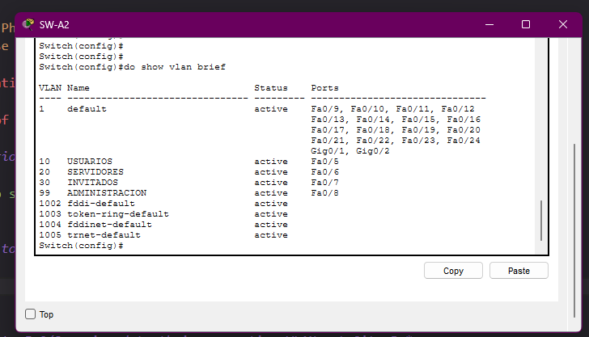

*Figure 2: Ports Fa0/5 to Fa0/8 assigned to their respective VLANs at Site B.*

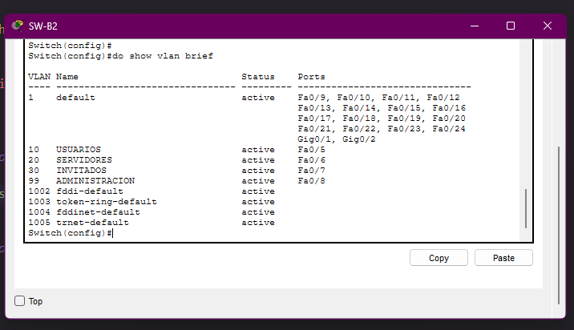

### 1.2. Verification of Trunk Links

*Evidence that ports connected to routers and between switches are tagging 802.1Q traffic.*

> **Command used:** `do show interfaces trunk` (on SW-A1 and SW-B1)

*Figure 3: Gigabit and FastEthernet interfaces operating in trunk mode and allowing the project VLANs at Site A.*

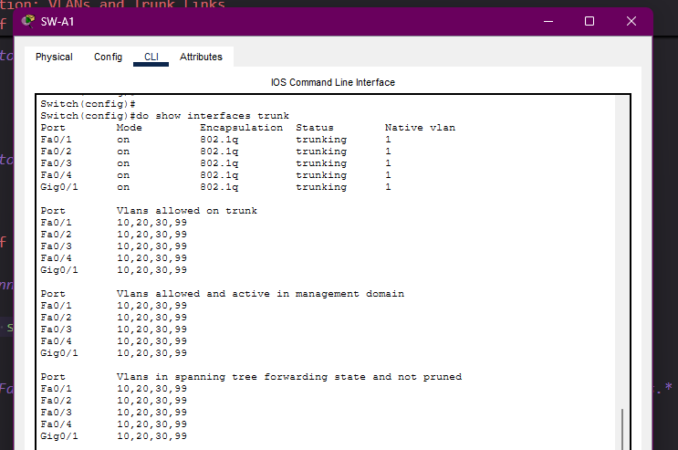
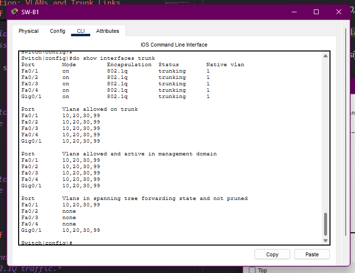

## 2. Local Layer 3: DHCP and Inter-VLAN Routing

### 2.1. IP Address Assignment via DHCP

*Evidence that end PCs correctly receive their IP, VLSM Mask, Gateway, and DNS server.*

*Figure 4: Users PC (VLAN 10, Site A) receiving dynamic IP configuration.*

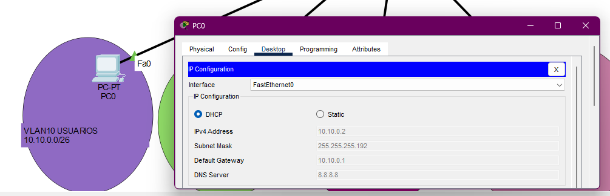

*Figure 5: Guests PC (VLAN 30, Site B) receiving dynamic IP configuration.*

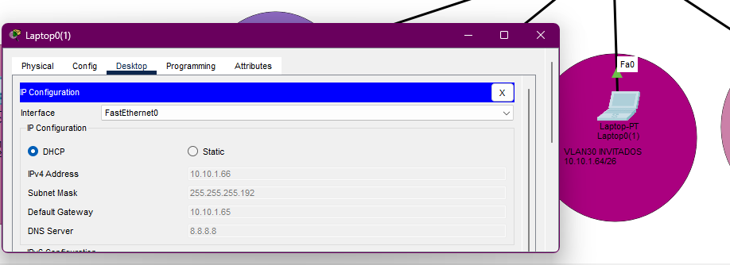

### 2.2. Inter-VLAN Connectivity (Router-on-a-Stick)

*Evidence of successful pings between devices in different VLANs within the same Site.*

*Figure 6: Ping from the Users PC (VLAN 10) to the Server (VLAN 20) at Site A.*

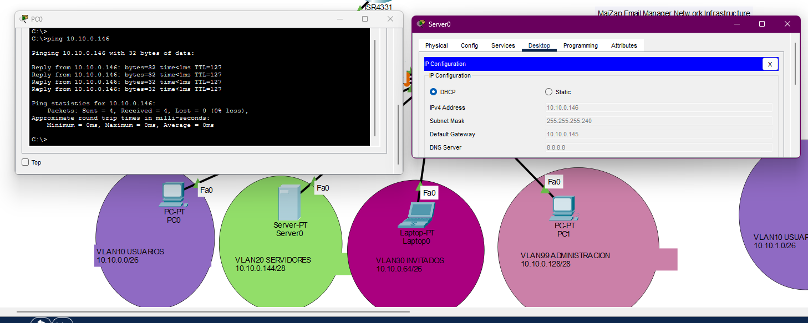

## 3. Dynamic Routing (EIGRP AS 10) and WAN Connectivity

### 3.1. Routing Table and EIGRP Adjacency

*Evidence that the routers have formed an adjacency and learned the routes from the remote site.*

> **Command used:** `do show ip route` (on Site A and Site B)

*Figure 7: Site A Router showing the 10.10.1.0/x networks learned via EIGRP (marked with 'D').*

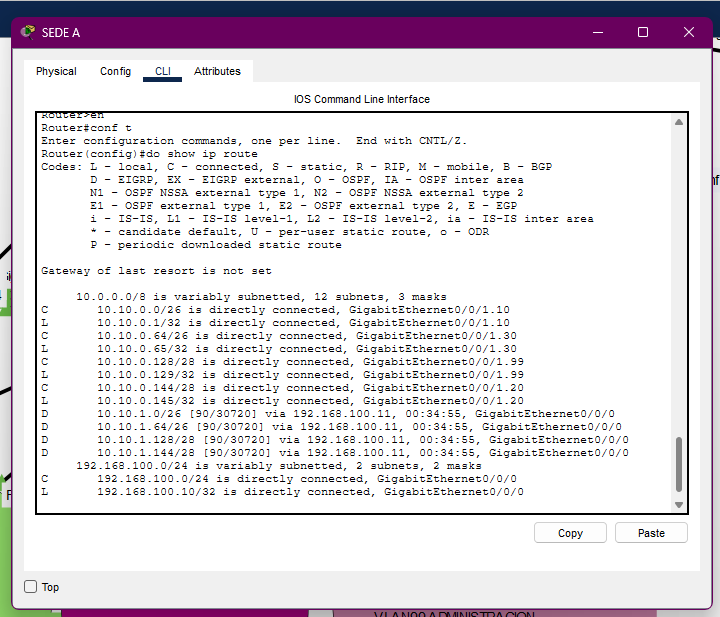
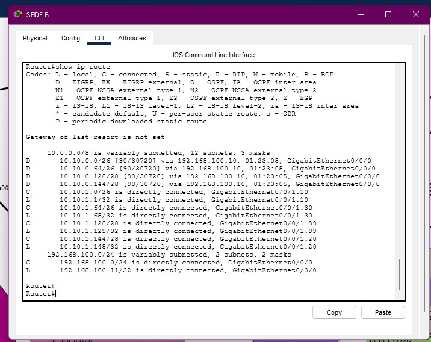

*Figure 8: Console message confirming 'Neighbor Adjacency' across the 192.168.100.0 network.*

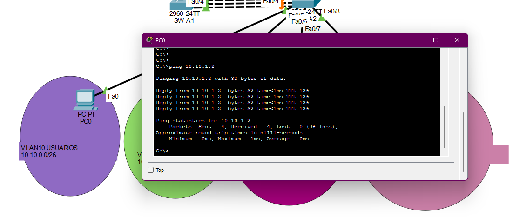

### 3.2. End-to-End Connectivity (Ping between Sites)

*Evidence that a device at Site A can communicate with a device at Site B through the shared link.*

*Figure 9: Successful ping from the Users PC at Site A (10.10.0.x) to the Users PC at Site B (10.10.1.x).*

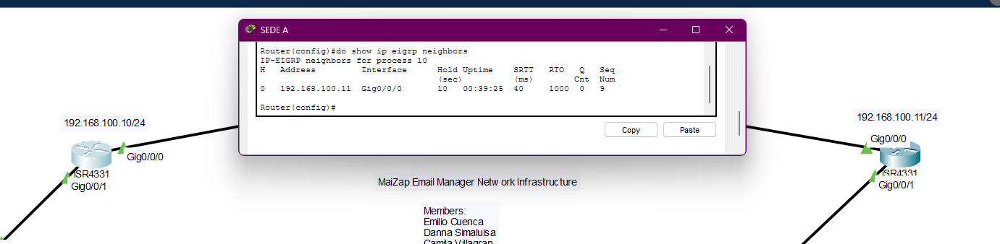
